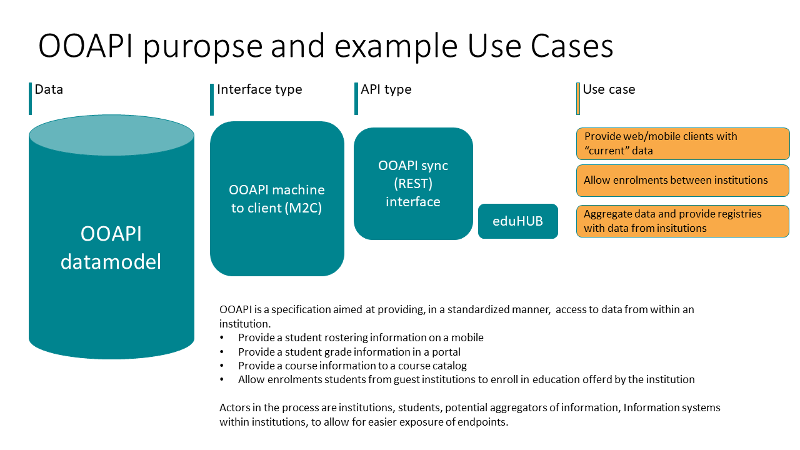

<!-- markdownlint-disable MD033 -->
<!-- markdownlint-disable MD059 -->
# Open Education API 6.0 for interoperability

For a brief introduction to OEAPI, please take a look at the short
video below:

<video id="html5_video_872" style="width: 100%; height: 100%;"
controls="controls" preload="auto" width="630" height="355">
<source type="video/mp4"
src="../_media/animation_open_onderwijs_api_uk_v2.mp4" />
</video>

Educational institutions are increasingly sharing education data:
with their students via apps, between different systems within an
institution and with other institutions.

The underlying data, however, are stored in various systems, such as
databases, both within and outside educational institutions. To be able
to communicate with these systems, a set of definitions known as an
Application Programming Interface (API) is required.

## A standard is needed

Of course, each school, college or university can develop its own APIs,
but this is a time-consuming and costly process. That is why the Open
Education API was created. OEAPI conforms to the design principles of
REST (Representational State Transfer), a flexible, lightweight way of
integrating applications.

This open API is the result of a collaboration between several
educational institutions and suppliers in the Netherlands. This
collaboration is facilitated by SURF, and its participants are known
collectively as the Community. Within the Technical Working Group of
the Community, OEAPI is constantly defined and developed so that new
and existing education data can be processed efficiently.

## OEAPI purpose

The aim of the OEAPI specification is to standardise the exchange of
information between institutions using the API. This enables developers
of future applications to work with well-defined endpoints, thereby
making system integration easier.

The original use case for OEAPI v5.0 is depicted in the figure below:

In the future, additional integration projects may be developed based
on the OEAPI information model.

## Benefits of using the Open Education API

Using the Open Education API (OEAPI) delivers clear efficiency gains for
organisations, as well as tangible improvements to the student journey.
By working with a shared open standard, institutions can innovate more
quickly while offering students a more coherent digital experience.

### Benefits for development teams

- Faster development cycles thanks to standardisation
- No major upfront investment required to get started
- Easier data exchange with other educational institutions
- No need to build and maintain bespoke APIs for each partner or system
- Reuse of third-party applications across multiple institutions
- Secure information sharing within a trusted ecosystem
- Continuous knowledge sharing through collaboration with other
  institutions using OEAPI

### Benefits for students and their educational journey

By incorporating OEAPI into the IT landscape, students can easily:

- Use a smartphone to find the nearest available computer
- Check the status of their study credits via an app
- Register online for courses or tests
- View class timetables on a smartphone
- Securely access examination results
- And much more

To protect personal data, such as examination results and timetables, it
is recommended to use an authorisation server that supports OAuth 2.0, in
combination with SURFconext. These security measures are not part of
OEAPI itself, but their use is strongly advised.

## OEAPI is widely supported

Via the Dutch Npuls programme, MBO, HBO and WO institutions have
embraced the OEAPI standard. Implementation of the standard is needed
to be future-ready. Both Dutch and international institutions are
working with the OEAPI standard. Check out the
[Npuls programme](https://npuls.nl/en/) and specifically more information
about [Technology Infrastructure](https://npuls.nl/en/technology-infrastructure/).

Increasingly, there are international initiatives and use cases.
Check out the page about international usage and find out more on
our use cases page.

## Creating a standard together

Apps are constantly evolving. To create an all-encompassing standard
API, it is essential to understand the ever-changing needs of the
various educational institutions. Therefore, the Community places great
value on working closely together to create a standard API, OEAPI,
that best serves as many educational institutions in the Netherlands
as possible.

Furthermore, educational institutions that want to publish education
data in a standardised way can implement their own API based on the
OEAPI standard.

## Interested in joining us?

Are you an educational institution interested in having OEAPI
developed to suit your needs? Then why not join us? You can find more
information [here](/contributing/contact.md).
