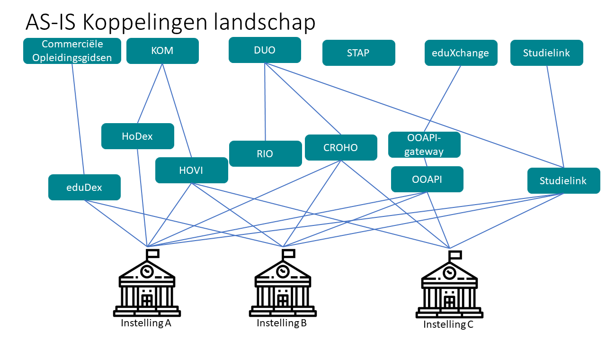
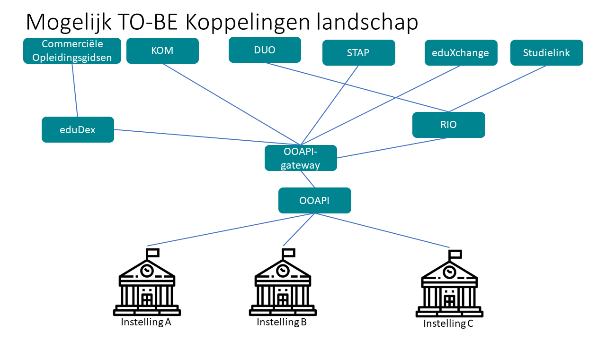

# Architecture

To facilitate future ROSA scans, additional information is provided
about the OEAPI specification.

A general overview of the rationale behind the specification and how it
relates to other elements is provided, using the ROSA scan
structure.

## OEAPI (data) ownership

The OEAPI Specification is a set of definitions that enable institutions
to make their internal data accessible. The specification is
maintained by the working group. Changes to the specification can be made
according to the [governance by-laws](/governance/).

Institutions that wish to provide access to their internal data through
the OEAPI specification do so under their own responsibility. The OEAPI
working group has provided an overview of the classification of the
different endpoints. The data provided by institutions is owned by the
institutions or ownership is delegated on behalf of students. In the
latter case, students agree to have their data processed by the
institution.

When data is aggregated, for example for the purpose of a course
catalogue or a combined cross-institutional timetabling app, ownership
of the data remains with the student or institution.

## Supply chain

Currently, institutions for Higher Education face significant overhead
in developing and supporting different types of data exchanges. In the
current AS-IS situation, most of the effort required to provide data to
potential users of the data, such as DUO, KOM, eduXchange, etc., lies
with the institutions. They need to provide a broad set of interfaces.

Further development of the OEAPI and the provision of additional
support for other interface types on top of the current data model
would alleviate the amount of effort needed by the institutions. A
possible future would then look like the image below.

