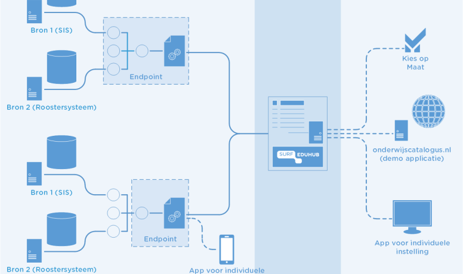

# References

Currently the OEAPI is implemented at: universities of applied sciences,
universities and cross-sectoral. An example of the latter is a tool
implemented for the acceleration
[zone flexible education](https://www.versnellingsplan.nl/en/making-education-more-flexible/index.html).
Another example of such cross-sectoral implementations is the current
development of the RIO adapter and SURFeduhub.

