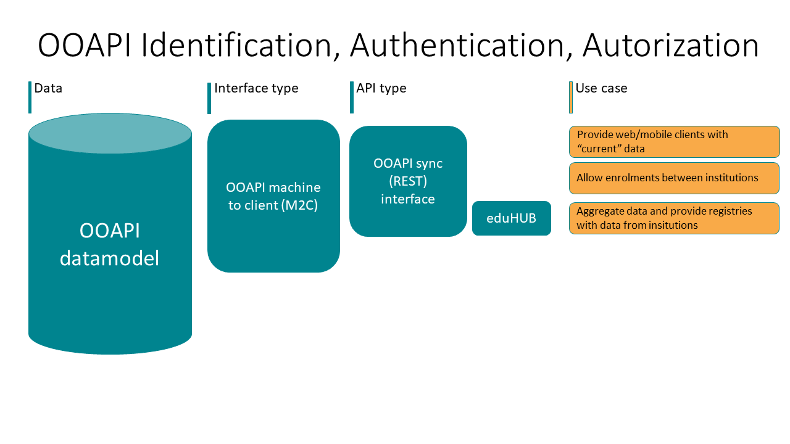

# IAA (Identification, Authentication and Authorisation)

Although the name Open Education API might suggest that all data
provided by an API is open to the public, this is not the case. The
implementation of the different OEAPI requests and responses requires
different types of security.

A typical implementation of OEAPI exposes internal (data) service
endpoints for external consumption. This can be either through
additional aggregation, e.g. an OEAPI gateway, or directly from the
OEAPI endpoints of institutions (e.g. Leiden University or Inholland).
The next figure provides an overview of components that are usually
used.

## IAA not within scope of the specification

To optimise the use and adoption of the Open Education API (with a
focus on providing a standardised API based on the underlying semantic
data model), the specification does not prescribe a specific
authentication and authorisation method. Whilst having a clear stance
and a prescriptive choice in this area could be valuable for parties
implementing the API technically, we also recognise that it could hinder
adoption. For this reason, we aim to recommend a proven, widely
supported and easy-to-implement authentication standard.

## Minimal level of classification

Since the current OEAPIv5 implementation only provides information via
a REST API, based on the
[OpenAPI specification 3.0](https://swagger.io/specification/),
we suggest that API endpoints with CIA (Confidentiality, Integrity,
Availability) scores above 'LLL' implement security measures for
accessing the endpoints. The types of security measures would depend on
the sensitivity of the types of data exposed by the endpoint.

## Internet standards for Identification and authentication

To ensure secure data exchange, we recommend using an open and dominant
standard that is actively being developed. Proper implementation and
use of a security standard are crucial. Choosing an open and widely
used standard ensures broad support from vendors and/or the availability
of sufficient libraries for correct implementation, ultimately
achieving the main goal: secure data exchange. The Dutch 'Forum
Standaardisatie' [forumstandaardisatie.nl](https://www.forumstandaardisatie.nl/) is a valuable
resource for consulting advice on the use of open standards.

Based on the above, we recommend the OAuth2 protocol, an open standard
developed and maintained within the IETF.

For machine-to-machine (M2M) data exchange (where user authorisation is
not required), we recommend, as a best practice, using the
[OAuth2](https://oauth.net/2/grant-types/client-credentials)
client credentials grant type for authenticating and authorising the
client to access the data.

For an implementation requiring delegated user access to approve data
processing, we recommend using the OpenID Connect flow, based on the
[OAuth2 authorisation code flow](https://openid.net/developers/how-connect-works)

For both flows, we recommend supporting both JWT and reference tokens
for access tokens.

[SURFconext also provides OIDC](https://servicedesk.surf.nl/wiki/spaces/IAM/pages/128910009/Tutorials).
The OpenID Connect authentication flow supported by SURFconext can be
found in the
[SURFconext wiki](https://servicedesk.surf.nl/wiki/spaces/IAM/pages/128910041/OpenID+Connect+authentication+flow).

## Authorisation at multiple levels

For handling authorisation, this is usually either business rule-based,
which would be handled in the data services themselves, or in the API
manager when rules pertain to:

* device
* key
* IP range
* throttling

Of course, the API manager itself could also have additional security
measures, such as firewalls, whitelisting for specific endpoints or
Access Control Lists.

In the OEAPI IAA efforts, we conform to the
[IAA vision of SURF](https://www.surf.nl/files/2019-02/visiedocument_iaa_surfnet.pdf).

In the eduXchange project, the OAuth token of the student is used to
exchange information on their behalf.

# Mapping OEAPI to BIV

## CIA and BIV

CIA (or, in Dutch, BIV) classifications help institutions choose proper
measures to secure and optimise systems that have been classified. CIA is
an acronym for Confidentiality, Integrity and Availability. More
information on [CIA/BIV classificatie](https://nl.wikipedia.org/wiki/BIV-classificatie).

## Institutions in the lead

Determining the CIA classification of an OEAPI endpoint is usually done
by institutions themselves, as they are in the best position to assess
impact regarding, for instance, availability issues.

## Classification through mapping

This document helps institutions to get a general overview of the
objects within the specification and their preliminary CIA
classification. The objects and specifically the endpoints in question
are [OEAPI endpoints](https://oeapi.eu/specification/v6.0).
To make a preliminary CIA classification, we have chosen to map the
endpoints to
[HORA](https://www.wikixl.nl/wiki/hora/index.php/Hoofdpagina).
This is done by mapping the OEAPI objects to HORA business objects.
These HORA business objects already have a CIA consensus from architects
at the educational institutions.

## The OEAPI objects

## Description of the objects

| OEAPI object | OEAPI endpoint | description |
| --- | --- | --- |
| service | "/" | The service additional metadata needed to make the OEAPI fit for this organisation. |
| organisation | "/organisations" | The organisations that are responsible for the execution and recognition of education. |
| organisationRelation | "/organisations" | The relations between different organisations, mainly parent-child relations or indication of root. |
| programme | "/programmes" | A coherent set of educational courses, aimed at the realisation of competences or objectives in the field of knowledge, insight, attitudes and skills that the person who completes the programme must have. |
| programmeRelation | "/programmes" | The relations between different programmes, mainly parent-child relations or indication of root. |
| course | "/courses" | A coherent set of educational components, aimed at the realisation of competences or objectives in the field of knowledge, insight, attitudes and skills that the person who completes the course must have. |
| learningComponent | "/learning-components" | A learning component is a part of a course. |
| testComponent | "/test-components" | A test component is a part of a course. |
| programmeOffering | "/programme-offerings/{programmeOfferingId}" | An offering of a specific programme in an academicSession. |
| courseOffering | "/course-offerings/{courseOfferingId}" | An offering of a specific course in an academicSession. |
| learningComponentOffering | "/learning-component-offerings/{learningComponentOfferingId}" | An offering of a specific learning component in an academicSession. |
| testComponentOffering | "/test-component-offerings/{testComponentOfferingId}" | An offering of a specific test component in an academicSession. |
| academicSession | "/academic-sessions" | The academic sessions provide information about the different time periods a programme, course, learning component or test component can be offered. |
| programmeOfferingAssociation | "/programme-offering-associations/{programmeOfferingAssociationId}" | A programme offering association provides information regarding the association between a programme offering and a person. |
| courseOfferingAssociation | "/course-offering-associations/{courseOfferingAssociationId}" | A course offering association provides information regarding the association between a course offering and a person. |
| learningComponentOfferingAssociation | "/learning-component-offering-associations/{learningComponentOfferingAssociationId}" | A learning component offering association provides information regarding the association between a learning component offering and a person. |
| testComponentOfferingAssociation | "/test-component-offering-associations/{testComponentOfferingAssociationId}" | A test component offering association provides information regarding the association between a test component offering and a person. |
| testComponentOfferingAssociationAttempt | "/test-component-offering-associations/{testComponentOfferingAssociationId}/test-component-offering-association-attempts" | Planning and execution information on an attempt belonging to a test component offering association. |
| result (as part of an association) | association-specific endpoints | Result of a unit of study participation, study activity or test. |
| group | "/groups" | A collection of persons that has a relationship with an organisation and optionally an offering. |
| person | "/persons" | A person that has a relationship with this institution. |
| learningOutcome | "/learning-outcomes" | A statement regarding what a learner knows, understands and is able to do on completion of a learning process. |
| document | "/documents/{documentId}" | A document that can be referenced by other objects. |
| room | "/rooms" | Rooms are part of a building where an activity can take place. Including detailed information on the resources available, number of seats, etc. (Updated continuously) |
| building | "/buildings" | Building that is currently used by the organisation. Including all location details. |

## The HORA objects for education and education support

## CIA (BIV)

CIA (or BIV) is a triad of

- Confidentiality
- Integrity
- Availability

These three elements of the triad are then classified into 4 different levels:

- H = high
- M = medium
- L = low
- P = publicly available

## Overview of OEAPI endpoints and their classification

| Data element | Maps to HORA object | HORA CIA* | HORA BIV |
| --- | --- | --- | --- |
| service | Not part of HORA (could be part of Institution: "Instelling") | LLL | LLL |
| organisation | Organisation "Organisatie" | LLL | LLL |
| organisationRelation | Organisation "Organisatie" | LLL | LLL |
| programme | Collection of units of study, Study, Programme, Collection of units of study "Samenhangende collectie van onderwijseenheden, Opleiding, Onderwijsprogramma" | LHM | MHL |
| programmeRelation | Not part of HORA (could be part of Study, Programme, Minor, Unit of study: "Opleiding, Onderwijsprogramma, Minor, Onderwijseenheid") | LHM | MHL |
| course | Unit of study "Onderwijseenheid" | PHM | MHP |
| learningComponent | Learning activity "Leeractiviteit" | LHM | MHL |
| testComponent | Test activity "Toetsactiviteit" | LHM | MHL |
| programmeOffering | Collection of units of study in which a student can enrol, Exam programme "Examenprogramma" | LHM | MHL |
| courseOffering | Unit of study implementation "Onderwijseenheiduitvoering" | PHM | MHP |
| learningComponentOffering | Educational Activity "Onderwijsactiviteit" | LMM | MML |
| testComponentOffering | Educational Activity "Onderwijsactiviteit" | LMM | MML |
| academicSession | Not part of HORA (could be part of Exam programme, Unit of study implementation, Study activity "Examenprogramma, Onderwijseenheiduitvoering, Onderwijsactiviteit") | LHM | MHL |
| programmeOfferingAssociation | Unit of study participation, Study Activity "Onderwijseenheidresultaat, Toetsresultaat" | HMM | MMH |
| courseOfferingAssociation | Unit of study participation, Study Activity "Onderwijseenheidresultaat, Toetsresultaat" | HMM | MMH |
| learningComponentOfferingAssociation | Unit of study participation, Study Activity "Onderwijseenheidresultaat, Toetsresultaat" | HMM | MMH |
| testComponentOfferingAssociation | Unit of study participation, Study Activity "Onderwijseenheidresultaat, Toetsresultaat" | HMM | MMH |
| testComponentOfferingAssociationAttempt | Result of a unit of study participation, Study Activity or test "Onderwijseenheidresultaat, Toetsresultaat" | MHL | LHM |
| result (as part of an association) | Result of a unit of study participation, Study Activity or test "Onderwijseenheidresultaat, Toetsresultaat" | MHL | LHM |
| group | Collection of persons that has a relationship with an organisation and optionally an offering "Leergroep, Lesgroep" | LML | LML |
| person | Participant, Employee "Individu, Deelnemer, Alumnus, Medewerker, Contact" | HHM | MHH |
| learningOutcome | Not yet mapped | TBD | TBD |
| document | Not yet mapped | TBD | TBD |
| room | Room: "Ruimte" | MLM | MLM |
| building | Building: "Gebouw" | LMM | MML |

- When an OEAPI object maps to more than one HORA object the CIA classification
  is based on the highest values of the joint objects, e.g. if CIA for object
  one is LLH and for object two is HLL, the combined CIA classification results
  in HLH.

- Unit of Study. (Unit) means a component of a higher education course of study
  with a designated unit code, title and credit point allocation in which
  students enrol and undertake assessment tasks in order to achieve specified
  learning outcomes (based on
  [Law Insider](https://www.lawinsider.com/dictionary/unit-of-study)).

# Extending OEAPI

Implementations can extend OEAPI by adding extra attributes to the `ext`
object that is defined in the specification for most resources. Extending
OEAPI can also be done by specifying a specific consumer. This is a
mechanism that allows specifying an extension that can be more easily reused
across several implementations. See [Specific consumers](/contributing/README.md#community-governance)
for more information.

All users of OEAPI are encouraged to feed their extensions back to the OEAPI
Technical Working Group so this information can be used as feedback for future
versions of OEAPI.

## When to use `ext` and when to use `consumer`?

Use `ext` when:

- You only need a few extra attributes that will only be used by a limited
  set of clients or consuming systems.
- The attributes are specific to your own institution.
- The extension is implementation-specific and not intended for reuse across
  multiple institutions or systems.

Use `consumer` when:

- You need a set of extra attributes to supply a system that will be used by
  more than one institution.
- You would like to promote the use of this extension.
- The extension represents a reusable integration profile or consumer-specific
  agreement.

Consumer extensions are intended to improve reuse and interoperability between
implementations that share the same integration requirements.

## Do not add extra paths or resources

Adding extra paths or resources that are not defined in the specification is
discouraged. If you have a specific use case that cannot be served with the
existing resources and paths, we recommend contacting the OEAPI Technical
Working Group to determine how the specification should be updated to
accommodate your use case.

The preferred approach is to extend existing resources through the supported
extension mechanisms instead of introducing custom endpoints that reduce
interoperability between OEAPI implementations.
